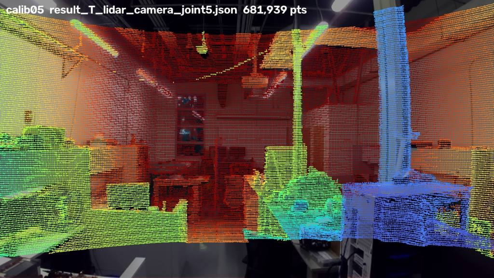

# lidar-zed-rig

A handheld rig that combines an **Ouster OS1-128 LiDAR** with a **Stereolabs ZED camera** to produce **colored 3D scans of rooms**, plus the software to record both sensors, calibrate them to each other and color the point cloud.



## What's here

| | |
|---|---|
| [`hardware/`](hardware/) | 3D-printable pistol grip that carries the OS1 on top and the ZED underneath (STL + Blender source) |
| [`src/lidarzed/`](src/lidarzed/) | Python package: recorder, camera tools, calibration helpers, coloring, scan evaluation |
| [`calibration/`](calibration/) | Calibration results per date (camera ↔ LiDAR transform, camera delay, lens file) |
| [`docker/`](docker/) | Headless image for the [direct_visual_lidar_calibration](https://github.com/koide3/direct_visual_lidar_calibration) toolbox |
| [`docs/`](docs/) | [Setup](docs/setup.md), [procedure](docs/procedure.md), [calibration report](docs/calibration-report.md), [project log](docs/project-log.md) |
| [`tests/`](tests/) | Tests that run without hardware |

## Highlights

- **No ZED SDK, no NVIDIA GPU:** the 1st-gen ZED is used as a plain USB camera; works on macOS and Linux.
- **One clock, no hardware sync:** both sensors are timestamped on arrival; the camera's 26 ms capture delay is measured from the data.
- **Targetless calibration:** no checkerboard; the room's own structure is used, starting from the grip's CAD geometry. Rotation is consistent to ~0.2° across recordings.
- **Coloring with motion:** every LiDAR point is placed with its own SLAM pose and colored from the image taken at the same moment, with a depth test against the camera's view.

## Quickstart

```bash
git clone https://github.com/JRussell02/lidar-zed-rig.git && cd lidar-zed-rig
python3 -m venv .venv && source .venv/bin/activate
pip install -e ".[calibration,plot,dev]"
cp config/rig.example.toml config/rig.toml        # set your OS1 hostname

lidarzed-record scan01 --duration 240              # walk the room slowly
ouster-cli source sessions/scan01/lidar.osf slam -v 0.1 save processed/scan01_slam.osf
lidarzed-colorize sessions/scan01 processed/scan01_slam.osf --out processed/scan01_color.ply
```

Open the PLY in [CloudCompare](https://www.cloudcompare.org). Full steps, including calibration, are in [docs/procedure.md](docs/procedure.md).

## Commands

| Command | Does |
|---|---|
| `lidarzed-record` | Record OS1 + ZED together (config in `config/rig.toml`) |
| `lidarzed-view` | Live ZED viewer (`--upside-down` for this grip) |
| `lidarzed-colorize` | Color a SLAM'd recording → PLY |
| `lidarzed-render` | Quick image of a colored PLY |
| `lidarzed-eval` | Scan fidelity: drift, ICP repeatability/merge, tape comparison |
| `lidarzed-make-bags` | Recordings → ROS 2 bags for the calibration toolbox |
| `lidarzed-init-guess` | Put a starting guess into the toolbox's `calib.json` |
| `lidarzed-overlay`, `lidarzed-edge-score` | Check a calibration visually / numerically |
| `lidarzed-refine-rotation`, `lidarzed-delay`, `lidarzed-height` | Rotation refit, camera delay, camera height |
| `lidarzed-snapshot` | One camera frame + a few scans, to check a scene before recording |

## Status

Calibrated and coloring works (see the [calibration report](docs/calibration-report.md)). Next: full room scans and accuracy evaluation.

## Acknowledgments

- [direct_visual_lidar_calibration](https://github.com/koide3/direct_visual_lidar_calibration) by Kenji Koide et al. (ICRA 2023), used via its Docker image.
- [Ouster SDK](https://github.com/ouster-lidar/ouster-sdk) for recording, SLAM and visualization.

## License

[MIT](LICENSE). Third-party tools keep their own licenses.
