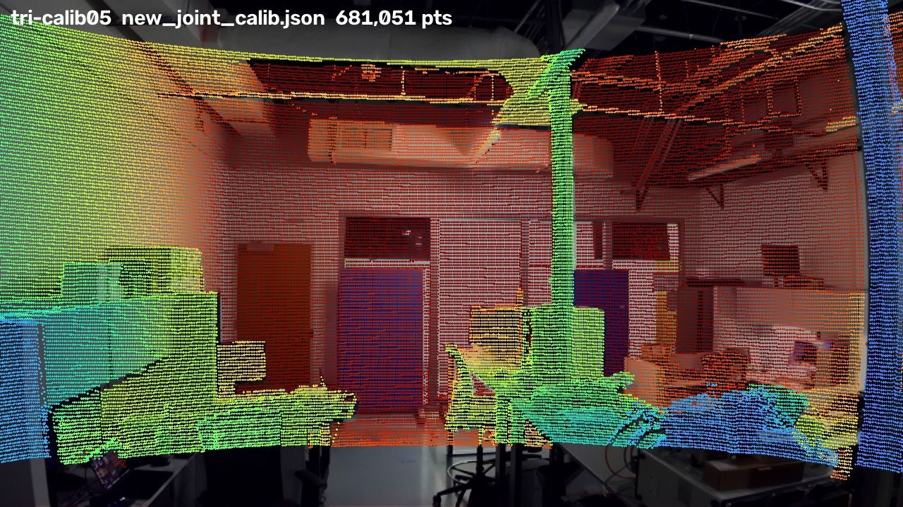
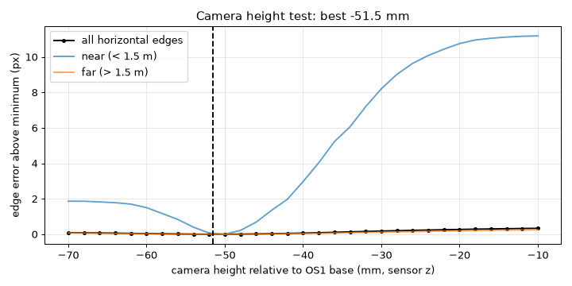

# Calibration Report: 5 Nov 2026

Recalibration after moving the sensors to a new mount: what changed on the rig, what was recorded, how the new calibration compares with the [28 Oct calibration](calibration-report.md), and what we learned along the way. The resulting files are in [`calibration/2026-11-05/`](../calibration/2026-11-05/).

**Rig:** Ouster OS-1-128 + Stereolabs ZED (1st gen) on the [tripod-grip mount](../hardware/) · **Compute:** Linux mini PC on a rolling cart

## Bottom line

| | Verdict | Details |
|---|---|---|
| **Recordings** | ✅ Good (5 / 5 usable) | 900 camera frames and ~605 LiDAR scans each, zero dropped frames, every recording stopped cleanly |
| **Calibration** | ✅ Better than 28 Oct | LiDAR edges land on image edges within **2.56 px** (was 3.56 px with the old calibration on the same recordings) |
| **Consistency** | ✅ Rotation within 0.15° | Each recording calibrated alone agrees with the joint result within 0.03–0.15° |
| **Camera height** | ✅ Settled | Box test: **−51.5 mm**, 3 mm from the calibration. The 28 Oct 2–3 cm doubt is resolved |
| **Change from 28 Oct** | 0.6° and 6 mm | The camera sits where the CAD says; remounting turned it by about half a degree |

## What changed on the rig

| Part | Before (28 Oct) | Now |
|---|---|---|
| Mount | 3D-printed pistol grip | Same plate with the handle cut off, bolted to a **tripod grip** (`hardware/tripod_grip_mount.stl`). OS1 bolt pattern and ZED mount identical to the grip within 0.5 mm in the CAD |
| OS1 firmware | 3.1.0, legacy IMU packets | **3.2.0**, IMU profile `ACCEL32_GYRO32_NMEA`. SLAM now corrects motion within each spin using the IMU (`InertialIntegrationImuDeskewMethod`) instead of assuming constant velocity |
| Everything else | | Unchanged: OS1 in 2048×10 mode, ZED at 720p / 15 fps on USB 3, same Linux mini PC |

Because the CAD positions match, the 28 Oct calibration was the starting guess, and it already scored better on the new recordings (3.56 px) than the CAD guess (5.04 px).

## What we recorded

Same procedure as 28 Oct: 60 s per recording, held still first (the tool's reference moment), then slow turns (±15–20°), tilts, a gentle roll and a small step. With the tripod grip the rig stood on a table for the still part.

| Recording | View | Still | Moving | Verdict |
|---|---|---:|---:|---|
| `tri-calib01` | Cabinet wall, desks, shelves | 20 s | 27 s | ✅ good; large blank wall on one side |
| `tri-calib02` | Cabinet wall from another spot, busy desks | 25 s | 27 s | ✅ good |
| `tri-calib03` | Length of the lab toward the whiteboard and window | 23 s | 23 s | ✅ good; most varied depths |
| `tri-calib04` | Whiteboard end, closer | 29 s | 31 s | ✅ usable; window and a glass tank in view |
| `tri-calib05` | Door and desk-row end | 19 s | 28 s | ✅ good |
| `tri-height01` | Box stack ~1.65 m away, far wall ~6.3 m behind, rig still for 30 s | 30 s | — | height test |

Each bag's reference image is within 24 ms of its first LiDAR scan (+7, −5, +5, −15, +24 ms).

## Calibration result

Same tool as 28 Oct: [direct_visual_lidar_calibration](https://github.com/koide3/direct_visual_lidar_calibration), targetless, all five recordings jointly, started from the 28 Oct result. It ran in its Docker container on the mini PC in about 25 minutes (preprocessing ~2–3 min per recording, joint calibration ~4 min, each single recording ~2 min).

| | Forward | Left | Up | Rotation |
|---|---:|---:|---:|---|
| 28 Oct (grip) | 76.9 mm | −52.2 mm | −50.7 mm | — |
| **5 Nov (tripod grip)** | **73.8 mm** | **−48.0 mm** | **−48.6 mm** | **0.61°** from 28 Oct |
| Difference | −3.2 mm | +4.2 mm | +2.1 mm | mostly a ~0.5° turn left/right, ~0.3° up/down |

The camera is held by one screw and two tabs, so a half-degree turn on reassembly is expected. Small as it is, 0.5° shifts colors by about 9 px everywhere in the image, which is why recalibrating after a remount is worth it.

### How well do LiDAR edges land on image edges?

Median distance in pixels between LiDAR object outlines and edges in the photo (`lidarzed-edge-score`). Lower is better.

| Recording | 28 Oct calibration | 5 Nov calibration |
|---|---:|---:|
| tri-calib01 cabinet wall | 4.0 | 3.0 |
| tri-calib02 cabinet wall, desks | 2.8 | 2.0 |
| tri-calib03 length of the lab | 4.0 | 3.0 |
| tri-calib04 whiteboard end | 4.0 | 2.8 |
| tri-calib05 door end | 3.0 | 2.0 |
| **Average** | **3.56** | **2.56** |

Every recording improved overall. By distance band, only one got slightly worse (tri-calib02 under 2 m: 2.2 → 2.8 px). For reference, the 28 Oct calibration scored 3.8 px on its own recordings.

*tri-calib05 with the new calibration (`lidarzed-overlay`): LiDAR points colored by distance (blue near, red far), drawn over the camera image and flipped upright. The steel post, door frames, blue boards and cabinet edges line up.*

### Cross-check: each recording calibrated on its own

Camera position relative to the OS1 base, in millimeters, and how far each rotation is from the joint result.

| Recording | Forward | Left | Up | Rotation diff |
|---|---:|---:|---:|---:|
| tri-calib01 | 74.6 | −46.1 | −54.3 | 0.10° |
| tri-calib02 | 73.8 | −49.6 | −48.9 | 0.03° |
| tri-calib03 | 70.6 | −49.9 | −46.9 | 0.05° |
| tri-calib04 | 73.5 | −38.5 | −49.6 | 0.08° |
| tri-calib05 | 73.8 | −43.6 | −38.5 | 0.15° |
| **Joint (all 5)** | **73.8** | **−48.0** | **−48.6** | — |

- **Rotation is very consistent:** 0.03–0.15°, tighter than on 28 Oct (0.16–0.45°, plus a 1.04° outlier). Rotation is what matters most for coloring.
- **Forward position is consistent** (70.6–74.6 mm).
- **Side and height positions spread more** (side −38.5 to −49.9 mm, height −38.5 to −54.3 mm), as on 28 Oct: rooms are full of vertical edges, which pin rotation down well but position poorly. `tri-calib04`'s side offset (+9.5 mm) likely comes from the glass in view; it was kept because its rotation agrees and the joint calibration improved its alignment the most.

### Camera height

`lidarzed-height` on `tri-height01` tries camera heights from −70 to −10 mm, re-fits the tilt for each, and measures how well horizontal LiDAR edges land on horizontal image edges.

*Near edges (blue) have a sharp minimum at −50 to −52 mm and are 11 px worse by −10 mm. Far edges (orange) barely depend on height, as expected.*

- Best fit **−51.5 mm**; the joint calibration says **−48.6 mm**. The 3 mm difference is under 2 px of color shift at 1 m, so the joint value is kept.
- This **settles the 28 Oct question.** The data then said ~50 mm below the OS1 base and a ruler said 24 mm; the box test now gives a clear minimum at ~50 mm. The ruler most likely measured to the camera body rather than to its optical center.

## Sensor sync

| Check | Status |
|---|---|
| Same clock | ✅ Unchanged: both sensors stamped on the computer clock |
| Camera delay | ✅ **26 ms**, carried over from 28 Oct. It is a camera/USB property and doesn't depend on the mount |
| Recording stop | ✅ Every recording stopped cleanly (`ouster-cli` exit −6 as usual, LiDAR file read back) |

## What the calibration means going forward

`calibration/2026-11-05/T_lidar_camera.json` replaces the 28 Oct calibration for this mount. `lidarzed-colorize` uses it to give each LiDAR point the color of the camera pixel it lands on. Recordings made before the switch can be colorized with it too, as long as they were made on the tripod-grip mount.

- It stays valid **only while nothing moves on the mount**. If the ZED or the OS1 is removed or re-screwed, recalibrate: about 15 minutes of recording plus ~25 minutes of processing ([procedure](procedure.md)).
- The 28 Oct calibration remains correct for recordings made on the pistol grip.

## Lessons from the session

- **Check the ZED's USB link after touching its cable.** After remounting, the ZED came up on USB 2 and silently fell back to VGA (1344×376). `lidarzed-record` and `lidarzed-snapshot` now stop with a message naming the USB speed; `lsusb -t` should show `5000M`.
- **Bring the LiDAR link back up after any unplug or power cut** (`scripts/os1_up.sh`): Ubuntu's default wired connection grabs the port and the OS1 becomes unreachable.
- **Detached recordings (`nohup lidarzed-record … &`) didn't stop `ouster-cli`.** Background jobs ignore SIGINT and `ouster-cli` inherited that, so the recorder waited 30 s and killed it, leaving the LiDAR file unfinalized. Fixed: the recorder restores SIGINT for `ouster-cli`.
- **Upload firmware from the mini PC, not through a browser over Wi-Fi.** The mini PC's Wi-Fi loses many packets; the browser upload broke off. Copying the image with a resumable `rsync`, checking its SHA-256, and POSTing it to `/api/v1/system/firmware` over the Ethernet cable worked (HTTP 204, back up in ~1.5 min).
- **The height test needs depth contrast.** A box on a cabinet in front of a wall 0.5 m behind it can't separate heights. What worked: the box on a chair in an open aisle, the far wall 4+ m behind, the box's top edge within the LiDAR's view (it sees only 21.5° down), and nobody holding anything.
- **Use the full machine when it's free.** With all 4 cores, the whole calibration took ~25 minutes. Keep the low priority (`nice`, low CPU shares) so other work on the shared machine comes first.
