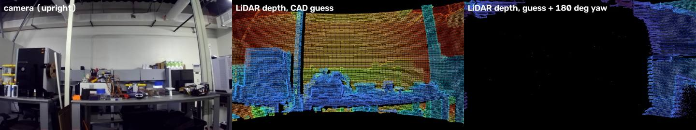

# Calibration Report: 28 Oct 2026

Status of the handheld LiDAR + camera rig after its first calibration session: what was recorded, whether the sensors are in sync, what the calibration result means, and what it costs in accuracy. The resulting files are in [`calibration/2026-10-28/`](../calibration/2026-10-28/).

**Rig:** Ouster OS-1-128 + Stereolabs ZED (1st gen) on the [3D-printed grip](../hardware/) · **Compute:** Linux mini PC on a rolling cart

## Bottom line

| | Verdict | Details |
|---|---|---|
| **Recordings** | ✅ Good (5 / 5 usable) | ~600 LiDAR scans and 901 camera frames each, zero dropped frames, every LiDAR file verified |
| **Sensor sync** | ✅ Same clock, delay measured | Both sensors timestamped on the computer clock; image ↔ scan pairs within 30 ms; camera delay **26 ms** |
| **Calibration** | ✅ Rotation solid · ⚠️ height ±2–3 cm | Rotation agrees within ~0.2° across recordings; camera height uncertain by 2–3 cm, negligible beyond 2 m |

## The rig

| Part | Details |
|---|---|
| LiDAR | Ouster **OS-1-128** (rev 7), mode 2048×10 (10 spins/s), vertical view +21.1° to −21.5°, built-in IMU. About 250 Mbps of data, so it needs **gigabit Ethernet**. |
| Camera | Stereolabs **ZED, 1st generation**. No IMU, so the OS1's IMU is the only one on the rig. Used as a USB camera (720p, 15 fps saved). Factory lens calibration downloaded by serial number. |
| Mount | 3D-printed pistol grip. OS1 on top; ZED hangs **upside down** under the front of the plate, looking forward. |
| Compute | Linux mini PC (Ubuntu 20.04) on a rolling cart with a power bank. OS1 on its built-in Ethernet port, ZED on USB 3. |

## What we recorded

Each calibration recording is 60 s: hold the rig still for 10 s (the calibration's reference moment), then slow turns, tilts, a gentle roll and a small step, each facing a different part of the lab.

| Recording | View | Verdict |
|---|---|---|
| `calib01` | Workbench and equipment | ✅ good |
| `calib02` | Door, cabinet, far whiteboard wall | ✅ good |
| `calib03` | Cubicles, room light on | ✅ good |
| `calib04` | Corner with door | ⚠️ weak: mostly flat wall |
| `calib05` | Deep view across the lab | ✅ best |
| `height01` | Box on a table at 0.9 m, rig still for 30 s | height test |

Retakes were kept as backups (shorter, closer, darker variants). Recordings are ~600 MB each and are not in this repository.

## Are the camera and LiDAR in sync?

| Check | Status |
|---|---|
| Same clock | ✅ LiDAR stamped by packet arrival time, camera by frame arrival time, both on the computer clock |
| Image ↔ scan pairing | ✅ ≤ 30 ms for every recording's reference moment |
| Motion inside a spin | ✅ Every LiDAR point carries its own time, so movement during the 0.1 s spin is corrected |
| Camera delay | ✅ **26 ms** (±3 ms): each ZED image arrives 26 ms after it was captured. Measured from the motion in calib01/02/03/05, which all agree (22, 24, 28, 28 ms) |

## Calibration result

We used the targetless tool [direct_visual_lidar_calibration](https://github.com/koide3/direct_visual_lidar_calibration) (Koide et al., ICRA 2023). It lines up the LiDAR's intensity image with the camera image using the room itself, so no checkerboard was needed. It started from a guess computed from the grip's CAD model.

*Left: camera. Middle: LiDAR depth projected into the camera with the CAD starting guess (blue = near, red = far). The columns, PC tower and 5 m far wall already line up. Right: the same guess rotated 180°, which shows only the operator behind the rig. This confirmed the LiDAR's forward direction.*

### How well do LiDAR edges land on image edges?

Median distance in pixels between LiDAR object outlines and edges in the photo (`lidarzed-edge-score`). Lower is better.

| Recording | CAD guess | Calibrated |
|---|---:|---:|
| calib01 workbench | 6.0 | 2.2 |
| calib02 door / far wall | 7.0 | 3.0 |
| calib03 cubicles | 4.4 | 4.0 |
| calib04 corner (flat wall) | 4.2 | 7.0 |
| calib05 deep view | 5.0 | 2.8 |
| **Average** | **5.3** | **3.8** |

*calib05 with the calibrated result (`lidarzed-overlay`): LiDAR points colored by distance, drawn over the camera image, flipped upright for viewing.*

### Cross-check: each recording calibrated on its own

Camera position relative to the OS1 base, in millimeters (forward, left, up), and how far each rotation is from the joint result.

| Recording | Forward | Left | Up | Rotation diff |
|---|---:|---:|---:|---:|
| calib01 | 74.7 | −45.7 | −53.1 | 0.16° |
| calib02 | 70.3 | −35.4 | −72.9 | 0.45° |
| calib03 | 74.1 | −54.1 | −42.8 | 0.31° |
| calib04 (outlier) | 115.6 | −104.1 | −40.6 | 1.04° |
| calib05 | 70.9 | −45.4 | −46.4 | 0.23° |
| **Joint (all 5)** | **76.9** | **−52.2** | **−50.7** | — |
| **Ruler + CAD** | **78.0** | **−60.0** | **−24.0** | — |

- **Rotation is reliable.** The four good recordings agree within 0.06–0.24° (spread). Rotation is what matters most for coloring.
- **Forward position is consistent** (70–75 mm, close to the CAD's 78 mm).
- **Height and side position are uncertain.** The data puts the camera 2–5 cm lower than a ruler measurement (24 mm). Most edges in the lab are vertical, so a vertical offset barely changes how well they line up. A still recording of a box edge (`height01`, `lidarzed-height`) gave the same ~50 mm best fit, but the zoomed edge sits between the two candidates; the true value is likely ~30–45 mm.

> **What a 2.5 cm position error costs:** about 18 px of color shift at 1 m, 9 px at 2 m and 4 px at 5 m. For room-scale scans (mostly beyond 2 m) any value in the range works. Close-up detail needs the height settled.

## What the calibration means going forward

`calibration/2026-10-28/T_lidar_camera.json` records exactly where the camera sits and which way it points relative to the LiDAR. It lets each LiDAR point take the color of the camera pixel it lands on, turning grey scans into colored 3D room models. A first test on calib05 produced 1.44 M correctly colored points (`lidarzed-colorize`).

- It stays valid **only while nothing moves on the mount**. If the ZED is removed or re-screwed, or the print flexes, recalibrate (about 15 minutes of recording plus processing; see [the procedure](procedure.md)).
- Use `T_lidar_camera.json`. Alternatives with the ruler height are in `alternatives/`.

## Lessons from the session

- **Hold still at the start of every calibration recording.** The tool takes its reference image and scan from the first moments.
- **Process one recording at a time** on a machine with ~8 GB of RAM, at 1 cm resolution.
- **The calibration tool opens an OpenGL window even in background mode;** our Docker image adds a virtual display for headless runs.
- **Re-seat USB cables** if the ZED disconnects: a reconnect makes the camera briefly "busy".
- **`ouster-cli` exits with −6 when stopped,** but the recording is fine; `lidarzed-record` reads it back to confirm.
