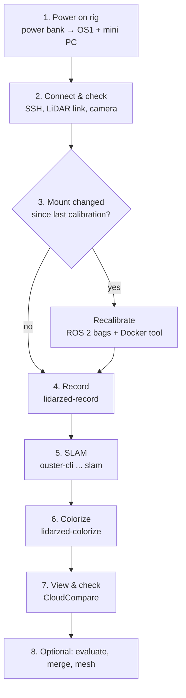

# Scan Pipeline: from power-on to a colored 3D model

How a scan works end to end with the OS1 + ZED rig, in order. For installation see [setup](setup.md); for calibration details see [procedure](procedure.md).

## Overview



| Step | Where it runs | Command | Output |
|---|---|---|---|
| 1. Power on | Rig + cart | — | OS1 spinning, mini PC up |
| 2. Connect & check | Mini PC (over SSH from a laptop) | `scripts/os1_up.sh`, `lidarzed-snapshot` | Sensors confirmed |
| 3. Calibration check | — | (recalibrate only if the mount changed) | `calibration/<date>/` |
| 4. Record | Mini PC | `lidarzed-record` | `sessions/NAME/` |
| 5. SLAM | Mini PC or laptop | `ouster-cli … slam … save` | `processed/NAME_slam.osf` |
| 6. Colorize | Mini PC or laptop | `lidarzed-colorize` | `processed/NAME_color.ply` |
| 7. View | Laptop | CloudCompare | — |
| 8. Optional | Laptop | `lidarzed-eval`, CloudCompare / MeshLab | merged cloud, mesh, accuracy numbers |

## Do we need separate scripts for the LiDAR and the camera?

**No. One command records both.** `lidarzed-record` starts the LiDAR recording itself (it launches `ouster-cli` in the background) and captures the ZED camera in the same program. Both are timestamped on the mini PC's clock, so they line up later. Stopping it (Ctrl+C, or `--duration` running out) stops both and checks the LiDAR file is readable.

## When is ROS used?

**Not for scanning.** Recording, SLAM and coloring use the Ouster SDK (`ouster-cli`) and our Python package, with no ROS involved.

ROS 2 is used **only when calibrating** the camera to the LiDAR, and only inside a Docker container:

1. `lidarzed-make-bags` converts calibration recordings into **ROS 2 bag files** (written with the pure-Python `rosbags` library, so nothing ROS needs to be installed on the computer).
2. The calibration toolbox (`direct_visual_lidar_calibration`, a ROS 2 package) runs **inside Docker** (`docker/vlcal.sh preprocess …` then `calibrate …`).
3. The result is copied into `calibration/<date>/T_lidar_camera.json`, which coloring uses from then on.

Calibration is a one-time job per mount. Redo it only if the camera or LiDAR moves on the grip.

---

## 1. Power on the rig

1. Turn on the **power bank** on the cart. It powers the **OS1 interface box** and the **mini PC**.
2. Check the cables:
   - OS1 → interface box → **Ethernet** into the mini PC.
   - ZED → **USB 3** port on the mini PC (push both ends in firmly; a loose cable makes the camera drop out).
3. Wait **30–60 s** for the OS1 to spin up and boot.

## 2. Connect and check

From a laptop on the same network, SSH into the mini PC, then:

```bash
cd ~/lidar-zed-rig && source .venv/bin/activate
scripts/os1_up.sh <sensor-host>      # brings the LiDAR's network link up and waits for the sensor
ls /dev/video*                        # the ZED should appear (Linux)
```

Optional but recommended before an important scan: grab one camera frame and a few LiDAR scans to check the scene and that both sensors respond.

```bash
lidarzed-snapshot --sensor <sensor-host> --out snapshot/
```

> **After any LiDAR unplug or power cut**, run `scripts/os1_up.sh` again before recording.

## 3. Is the calibration still valid?

The calibration in `calibration/2026-10-28/` is valid **as long as nothing has moved on the mount**. If the ZED was removed or re-screwed, or the grip was reprinted, recalibrate first (see [procedure](procedure.md#3-calibrate-the-camera-to-the-lidar); this is the only part that uses ROS).

## 4. Record

```bash
lidarzed-record scan01 --no-viz --duration 240
```

- `scan01`: the session name (use a new one each time; the recorder refuses to overwrite).
- `--no-viz`: no live viewer (there's no screen over SSH; you check the result afterwards).
- `--duration 240`: stops by itself after 4 minutes. Leave it out to stop with Ctrl+C.

**What to do while it records:**
1. **Hold the rig still** for the first 3 s (the recorder prints `HOLD THE RIG STILL`).
2. Walk **slowly** (~0.5 m/s), turn slowly with your whole body, keep the rig **level and high**.
3. To capture under tables, lower the rig slowly to ~0.5 m and walk the rows, then raise it slowly.
4. **Finish where you started**, hold still for a few seconds.
5. Keep people out of the room if possible (moving people leave ghost points).

**When it finishes** it prints the number of camera frames and LiDAR scans saved. A typical minute is ~600 LiDAR scans and ~900 images. The session folder `sessions/scan01/` contains:

| File | What it is |
|---|---|
| `lidar.osf` | Raw LiDAR recording (~550 MB/min at 2048×10) |
| `zed/left/*.jpg` | Camera images, raw (upside down) |
| `zed/frames.csv` | Arrival time of every image |
| `meta.json` | Settings and frame counts |

The raw recording is kept, so every later step can be re-run with different settings without rescanning.

## 5. SLAM: work out the rig's path

```bash
ouster-cli source sessions/scan01/lidar.osf slam -v 0.1 save processed/scan01_slam.osf
```

SLAM (from the Ouster SDK) aligns the LiDAR scans to each other and stores the rig's position and orientation for **every column of every scan**, so motion during each 0.1 s spin is accounted for. About 30 s per minute of recording on a laptop.

Optional checks:

```bash
ouster-cli source sessions/scan01/lidar.osf slam -v 0.1 viz --map            # watch the map and path build (needs a screen)
ouster-cli source sessions/scan01/lidar.osf slam -v 0.1 save_trajectory processed/scan01_traj.csv
```

## 6. Colorize

```bash
lidarzed-colorize sessions/scan01 processed/scan01_slam.osf --out processed/scan01_color.ply
```

For every LiDAR scan, this:
1. places the points in the room using the SLAM path,
2. picks the camera image taken at the same moment (using the measured **26 ms** camera delay),
3. projects the points into that image using the **camera ↔ LiDAR calibration**, skipping points the camera can't see,
4. averages the colors into a cloud with 2 cm spacing.

About 30–40 s per minute of recording on a laptop. Only areas the camera has seen get colored, so face the camera at everything you want in color.

## 7. View and check

- Open `processed/scan01_color.ply` in **CloudCompare** (File → Open). Raise the point size to 2–3 and turn on **Display → Shaders → EDL** for depth.
- Or make a quick image without a viewer: `lidarzed-render processed/scan01_color.ply --out scan01.jpg`.

What to look for: walls appearing **twice** (SLAM drift, so walk slower or re-record), colors **sliding off** edges (calibration or timing), missing areas (not seen by the camera).

## 8. Optional next steps

| Goal | How |
|---|---|
| Measure accuracy | Tape-measure distances in the room, measure the same in CloudCompare, compare with `lidarzed-eval refs measurements.csv` |
| Check drift | Start and end on a floor mark; `lidarzed-eval drift processed/scan01_traj.csv` |
| Combine several scans | `lidarzed-eval align processed/a.ply processed/b.ply --merge processed/merged.ply` (only helps if the scans agree) |
| Make a solid model | CloudCompare → compute normals → **Poisson Surface Reconstruction** (or MeshLab), export OBJ/PLY |

## Quick reference

```bash
# on the mini PC, every scan
scripts/os1_up.sh <sensor-host>
lidarzed-record scanNN --no-viz --duration 240

# afterwards (mini PC or laptop)
ouster-cli source sessions/scanNN/lidar.osf slam -v 0.1 save processed/scanNN_slam.osf
lidarzed-colorize sessions/scanNN processed/scanNN_slam.osf --out processed/scanNN_color.ply
# open processed/scanNN_color.ply in CloudCompare
```

### Older script names

Machines set up before the package layout use the equivalent scripts:

| Package command | Older script |
|---|---|
| `lidarzed-record` | `python rig_record.py` |
| `lidarzed-colorize` | `python -I tools/colorize.py` |
| `lidarzed-snapshot` | `python tools/live_snapshot.py` |
| `scripts/os1_up.sh <host>` | `tools/os1_up.sh` |
