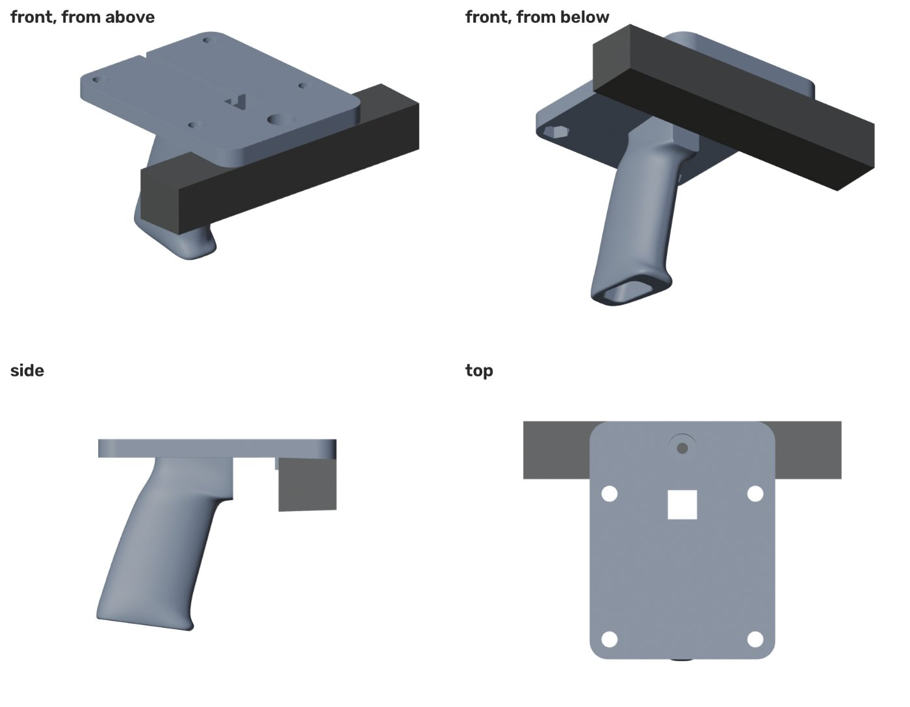

# Hardware: handheld grip

A 3D-printed pistol grip that carries the Ouster OS1 on top and the ZED camera underneath, facing forward.

| File | What it is |
|---|---|
| `grip_with_zed_mount.stl` | **Print this.** Final grip with the ZED mount (watertight, 102 × 132 × 105.5 mm, ~189 cm³) |
| `mount_handle.blend` | Blender source (5.x, units in mm). The ZED mount features are boolean modifiers on `hand_grip`; the dark box is a ZED stand-in |
| `hand_grip.stl` | Original grip without the ZED mount (102 × 103 × 105.5 mm) |

## Design

- **Plate:** 102 mm wide, 10 mm thick, extended forward to carry the camera. Coordinates in the Blender file: origin at the plate's underside center, +Z up, **front = −Y** (the finger-groove side).
- **OS1 mount:** 4 holes on an **80.2 mm square**: 8.8 mm clearance through the top 3 mm, then a hex pocket (13.3 mm across flats, 6.5 mm deep) on the underside for M8 nuts or captive M8 bolt heads. **Check this pattern against your OS1's base drawing before printing.**
- **ZED mount:** the ZED hangs **upside down** under the front of the plate, held by one 1/4"-20 screw from above (6.1 mm hole with a 15.8 mm counterbore) into its tripod thread. Two tabs against the back of the camera stop it rotating. It looks straight forward (no tilt).
- **Cables:** the ZED cable comes up through the 16 × 16 mm square hole and runs back along the groove on top; the OS1 connector faces the back too.
- **Grip:** ~95 mm long, ~17° rake, hollow with an open bottom.

## Printing

- **PETG or ASA**, not PLA: the OS1's base gets warm.
- 5+ walls, 40%+ infill, plate face down.
- The narrow section where the grip meets the plate carries the sensors' weight as a lever; don't skimp on walls there.
- Use thread-locker on the camera screw: the calibration is only valid while the camera can't move.

## Sensors

| | |
|---|---|
| LiDAR | Ouster OS1, 128 channels (rev 7). Needs gigabit Ethernet (~250 Mbps at 2048×10) and the interface box for power |
| Camera | Stereolabs ZED, 1st generation, used as a USB 3 camera (no ZED SDK). No IMU |
| Compute | Any computer with gigabit Ethernet + USB 3. We used a Linux mini PC on a rolling cart with a power bank, and a MacBook for development |

With the OS1's 38 mm-high measurement center and lowest beam at −21.5°, the plate's front edge clears the beams by ~13 mm, so the mount doesn't shadow the LiDAR.
